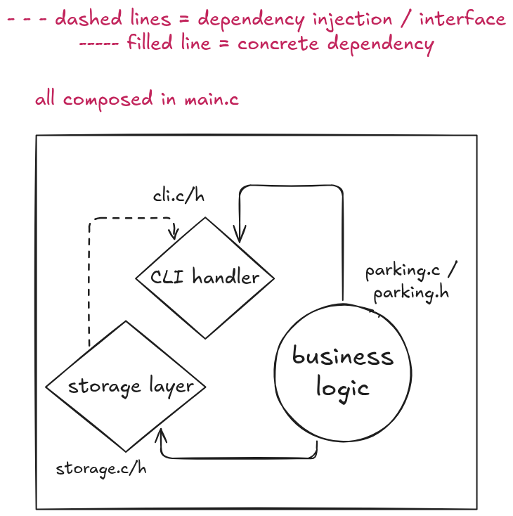

hi 

I will overengineer this project :b

**architecture**

## devlog

## pre-dev

### requirements 

build a functional parking system 

users must be able to park their car inside of a mall parking lot.

they should get a ticket first which allows them to park from time X to time Y at a spot.

### invariants 

- two cars cannot park in the same spot 
- when a ticket end time reaches, the spot must be freed
- a car cannot have multiple active tickets
- a ticket must reference a valid parking spot

### error handling / failure states 

user tries to get another ticket while one is active: return an error in the terminal.

user tries to get a ticket while all the spots are full: tell the user to come back when the ticket with the closest end time will be freed.

### module boundaries 

`cli` --> the CLI logic; has an interface which storage has a concrete implementation of (dependency injection)
`storage` --> the storage layer
`parking (business logic)` --> the layer which has generators for the structs, keeps the business logic, and has the return types for the interfaces

